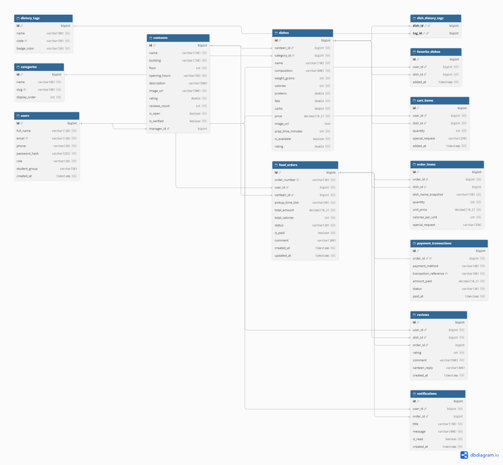

# CampusEats — Сервис предзаказа еды в буфетах и столовых кампуса

Веб-приложение для оформления предзаказа еды и напитков в университетских столовых и буфетах к конкретной перемене без очередей.

## Стек технологий

* **Бэкенд:** Java 17, Spring Boot 3.2.5 (Spring Web, Spring Data JPA, Validation)
* **Фронтенд:** Thymeleaf, Bootstrap 5 (адаптивная вёрстка под десктоп и мобильные устройства), Fetch API
* **База данных:** H2 Database (в файловом режиме PostgreSQL compatibility)
* **Маппинг и кодогенерация:** MapStruct 1.5.5, Lombok
* **Документация API:** SpringDoc OpenAPI 3 / Swagger UI

---

## Запуск проекта

1. Склонировать репозиторий и перейти в папку проекта:
   ```bash
   git clone https://github.com/IrtovaIrina/campus-eats.git
   cd campus-eats
   ```
2. Запустить приложение через Maven Wrapper или из среды разработки (IntelliJ IDEA):
   ```bash
   ./mvnw spring-boot:run
   ```
3. Открыть в браузере:
   * **Веб-интерфейс:** [http://localhost:8080](http://localhost:8080)
   * **Swagger UI (документация REST API):** [http://localhost:8080/swagger-ui.html](http://localhost:8080/swagger-ui.html)
   * **Консоль БД H2:** [http://localhost:8080/h2-console](http://localhost:8080/h2-console) (JDBC URL: `jdbc:h2:file:./data/campuseats_db`, User: `sa`, Password: пустой)

### Тестовые учётные записи

| Роль | Email | Пароль | Назначение |
| :--- | :--- | :--- | :--- |
| **Студент** (`STUDENT`) | `a.d.sokolov@campus.edu` | `student123` | Просмотр меню, фильтрация, корзина, предзаказ, оплата, трекинг, отзывы |
| **Буфет / Столовая** (`CANTEEN`) | `canteen.eng@campus.edu` | `canteen123` | Управление очередью заказов, смена статусов, CRUD меню, статистика, ответы на отзывы |
| **Администратор** (`ADMIN`) | `admin@campus.edu` | `admin123` | Сводная аналитика по кампусу, верификация и управление столовыми и буфетами |

---

## Ключевой сценарий (BPMN-процесс по архитектурным слоям)

**Сценарий:** Меню буфета ➔ Карточка блюда ➔ Корзина ➔ Оформление заказа (выбор времени и столовой) ➔ Статус-трекинг ➔ Личный кабинет с историей заказов.


---

## Архитектура базы данных (12 сущностей + таблица связи M:N)

Ниже представлена структура таблиц БД для визуализации в **Draw.io** / **DrawSQL** / **dbdiagram.io**:




### Описание сущностей базы данных

1. **`users`** — учётные записи пользователей системы (ФИО, контакты, роль `STUDENT`/`CANTEEN`/`ADMIN`, учебная группа).
2. **`canteens`** — столовые и буфеты кампуса (название, корпус, этаж, график работы, рейтинг, статус открытия и верификации, привязка к менеджеру).
3. **`categories`** — справочник категорий блюд и напитков для навигации и сортировки в меню (`name`, `slug`, `display_order`).
4. **`dietary_tags`** — справочник диетических меток и особенностей питания с цветовым кодированием бейджей (`name`, `code`, `badge_color`).
5. **`dishes`** — позиции меню конкретной столовой с ценой, составом, весом, КБЖУ, временем приготовления, рейтингом и статусом наличия.
6. **`dish_dietary_tags`** — связующая таблица (`M:N`) между блюдами (`dishes`) и диетическими метками (`dietary_tags`).
7. **`favorite_dishes`** — избранные блюда пользователей для быстрого доступа к любимым позициям меню.
8. **`cart_items`** — позиции в текущей корзине пользователя с указанием количества и пожеланий к приготовлению (`special_request`).
9. **`food_orders`** — оформленные предзаказы с уникальным номером, выбранным интервалом выдачи (`pickup_time_slot`), итоговой суммой, калорийностью, статусом заказа и отметкой об оплате.
10. **`order_items`** — состав оформленного заказа с фиксацией названия (`dish_name_snapshot`), цены и калорийности блюда на момент покупки.
11. **`payment_transactions`** — история и детали платёжных транзакций по заказам (метод оплаты, референс, сумма, статус и время проведения).
12. **`reviews`** — отзывы и оценки студентов по выполненным заказам и конкретным блюдам, а также официальные ответы столовой (`canteen_reply`).
13. **`notifications`** — системные уведомления для пользователей о статусах их заказов и событиях в приложении.
