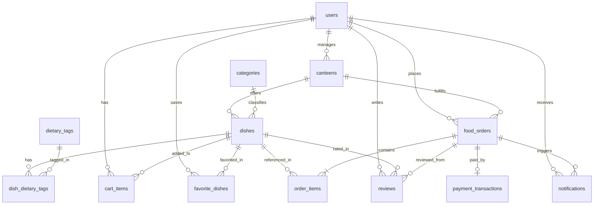

# CampusEats — Сервис предзаказа еды в буфетах и столовых кампуса

Веб-приложение для оформления предзаказа еды и напитков в университетских столовых и буфетах к конкретной перемене без очередей.

## Стек технологий

* **Бэкенд:** Java 17, Spring Boot 3.2.5 (Spring Web, Spring Data JPA, Validation)
* **Фронтенд:** Thymeleaf, Bootstrap 5 (адаптивная вёрстка под десктоп и мобильные устройства), Fetch API
* **База данных:** H2 Database (в файловом режиме PostgreSQL compatibility)
* **Маппинг и кодогенерация:** MapStruct 1.5.5, Lombok
* **Документация API:** SpringDoc OpenAPI 3 / Swagger UI

---

## Запуск проекта

1. Склонировать репозиторий и перейти в папку проекта:
   ```bash
   git clone https://github.com/IrtovaIrina/campus-eats.git
   cd campus-eats
   ```
2. Запустить приложение через Maven Wrapper или из среды разработки (IntelliJ IDEA):
   ```bash
   ./mvnw spring-boot:run
   ```
3. Открыть в браузере:
   * **Веб-интерфейс:** [http://localhost:8080](http://localhost:8080)
   * **Swagger UI (документация REST API):** [http://localhost:8080/swagger-ui.html](http://localhost:8080/swagger-ui.html)
   * **Консоль БД H2:** [http://localhost:8080/h2-console](http://localhost:8080/h2-console) (JDBC URL: `jdbc:h2:file:./data/campuseats_db`, User: `sa`, Password: пустой)

### Тестовые учётные записи

| Роль | Email | Пароль | Назначение |
| :--- | :--- | :--- | :--- |
| **Студент** (`STUDENT`) | `a.d.sokolov@campus.edu` | `student123` | Просмотр меню, фильтрация, корзина, предзаказ, оплата, трекинг, отзывы |
| **Буфет / Столовая** (`CANTEEN`) | `canteen.eng@campus.edu` | `canteen123` | Управление очередью заказов, смена статусов, CRUD меню, статистика, ответы на отзывы |
| **Администратор** (`ADMIN`) | `admin@campus.edu` | `admin123` | Сводная аналитика по кампусу, верификация и управление столовыми и буфетами |

---

## Ключевой сценарий (BPMN-процесс по архитектурным слоям)

**Сценарий:** Меню буфета ➔ Карточка блюда ➔ Корзина ➔ Оформление заказа (выбор времени и столовой) ➔ Статус-трекинг ➔ Личный кабинет с историей заказов.

```mermaid
flowchart LR
    classDef role fill:#dcfce7,stroke:#16a34a,stroke-width:2px,color:#064e3b
    classDef front fill:#e0f2fe,stroke:#0284c7,stroke-width:2px,color:#0c4a6e
    classDef back fill:#f3e8ff,stroke:#9333ea,stroke-width:2px,color:#3b0764
    classDef db fill:#f1f5f9,stroke:#475569,stroke-width:2px,color:#0f172a

    subgraph COL_ROLE ["1. Роли (Студент / Буфет)"]
        direction TB
        R1(["1. Студент: выбор меню и фильтров"])
        R2(["2. Студент: просмотр карточки блюда"])
        R3(["3. Студент: добавление в корзину"])
        R4(["4. Студент: выбор времени и оплата"])
        R5(["5. Буфет: смена статуса приготовления"])
        R6(["6. Студент: трекинг и история в ЛК"])
        R1 --> R2 --> R3 --> R4 --> R5 --> R6
    end

    subgraph COL_FRONT ["2. Фронтенд (Thymeleaf UI + Fetch)"]
        direction TB
        F1["Страница каталога<br/>GET /?tab=catalog<br/>fetch('/api/v1/dishes')"]
        F2["Карточка блюда<br/>GET /?tab=dish"]
        F3["Корзина<br/>POST /ui/cart/add<br/>fetch('/api/v1/cart')"]
        F4["Оформление и оплата<br/>POST /ui/orders/checkout<br/>POST /ui/payments/pay"]
        F5["ЛК Буфета: заказы<br/>POST /ui/canteen/status"]
        F6["Трекинг и История в ЛК<br/>GET /?tab=orders<br/>POST /ui/orders/repeat"]
        F1 ~~~ F2 ~~~ F3 ~~~ F4 ~~~ F5 ~~~ F6
    end

    subgraph COL_BACK ["3. Бэкенд (Spring Boot)"]
        direction TB
        B1["DishCatalogService<br/>searchAndFilterDishes()"]
        B2["DishCatalogService.getDishDetails()<br/>ReviewService.getReviewsForDish()"]
        B3["CartService<br/>addItemToCart() / getUserCart()"]
        B4["OrderService.checkoutFromCart()<br/>PaymentService.processDemoPayment()"]
        B5["CanteenOrderService<br/>updateOrderStatus()"]
        B6["OrderService<br/>trackOrder() / repeatOrderToCart()"]
        B1 ~~~ B2 ~~~ B3 ~~~ B4 ~~~ B5 ~~~ B6
    end

    subgraph COL_DB ["4. База данных (H2 Database)"]
        direction TB
        D1[("dishes, canteens,<br/>categories, dietary_tags")]
        D2[("dishes, reviews, users")]
        D3[("cart_items")]
        D4[("food_orders, order_items,<br/>payment_transactions")]
        D5[("food_orders,<br/>notifications")]
        D6[("food_orders, order_items,<br/>cart_items")]
        D1 ~~~ D2 ~~~ D3 ~~~ D4 ~~~ D5 ~~~ D6
    end

    R1 -- "Запрос" --> F1
    F1 -. "Ответ" .-> R1
    F1 -- "Запрос" --> B1
    B1 -. "Ответ" .-> F1
    B1 -- "SELECT" --> D1
    D1 -. "Ответ" .-> B1

    R2 -- "Запрос" --> F2
    F2 -. "Ответ" .-> R2
    F2 -- "Запрос" --> B2
    B2 -. "Ответ" .-> F2
    B2 -- "SELECT" --> D2
    D2 -. "Ответ" .-> B2

    R3 -- "Запрос" --> F3
    F3 -. "Ответ" .-> R3
    F3 -- "Запрос" --> B3
    B3 -. "Ответ" .-> F3
    B3 -- "INSERT/UPDATE" --> D3
    D3 -. "Ответ" .-> B3

    R4 -- "Запрос" --> F4
    F4 -. "Ответ" .-> R4
    F4 -- "Запрос" --> B4
    B4 -. "Ответ" .-> F4
    B4 -- "INSERT/DELETE" --> D4
    D4 -. "Ответ" .-> B4

    R5 -- "Запрос" --> F5
    F5 -. "Ответ" .-> R5
    F5 -- "Запрос" --> B5
    B5 -. "Ответ" .-> F5
    B5 -- "UPDATE/INSERT" --> D5
    D5 -. "Ответ" .-> B5

    R6 -- "Запрос" --> F6
    F6 -. "Ответ" .-> R6
    F6 -- "Запрос" --> B6
    B6 -. "Ответ" .-> F6
    B6 -- "SELECT/INSERT" --> D6
    D6 -. "Ответ" .-> B6

    class R1,R2,R3,R4,R5,R6 role
    class F1,F2,F3,F4,F5,F6 front
    class B1,B2,B3,B4,B5,B6 back
    class D1,D2,D3,D4,D5,D6 db
```



---

## Архитектура базы данных (12 сущностей + таблица связи M:N)

Ниже представлена структура таблиц БД для визуализации в **Draw.io** / **DrawSQL** / **dbdiagram.io**:

| № | Таблица в БД | JPA-сущность | Первичный ключ (PK) | Внешние ключи (FK) и связи | Основные поля и назначение |
| :-: | :--- | :--- | :--- | :--- | :--- |
| 1 | `users` | `User` | `id` (BIGINT) | — | `full_name`, `email` (UNIQUE), `phone`, `password_hash`, `role` (`STUDENT`, `CANTEEN`, `ADMIN`), `student_group`, `created_at` |
| 2 | `canteens` | `Canteen` | `id` (BIGINT) | `manager_id` ➔ `users.id` (N:1) | `name`, `building`, `floor`, `opening_hours`, `description`, `image_url`, `rating`, `reviews_count`, `is_open`, `is_verified` |
| 3 | `categories` | `Category` | `id` (BIGINT) | — | `name`, `slug` (UNIQUE), `display_order` — категории блюд в меню |
| 4 | `dietary_tags` | `DietaryTag` | `id` (BIGINT) | — | `name`, `code` (UNIQUE), `badge_color` — диетические особенности блюд |
| 5 | `dishes` | `Dish` | `id` (BIGINT) | `canteen_id` ➔ `canteens.id` (N:1)<br>`category_id` ➔ `categories.id` (N:1) | `name`, `composition`, `weight_grams`, `calories`, `proteins`, `fats`, `carbs`, `price`, `image_url`, `prep_time_minutes`, `is_available`, `rating` |
| 6 | `dish_dietary_tags` | *(Join Table)* | `(dish_id, tag_id)` | `dish_id` ➔ `dishes.id`<br>`tag_id` ➔ `dietary_tags.id` (M:N) | Связующая таблица многие-ко-многим между блюдами и диетическими тегами |
| 7 | `favorite_dishes` | `FavoriteDish` | `id` (BIGINT) | `user_id` ➔ `users.id` (N:1)<br>`dish_id` ➔ `dishes.id` (N:1) | `added_at` — список избранных блюд студента |
| 8 | `cart_items` | `CartItem` | `id` (BIGINT) | `user_id` ➔ `users.id` (N:1)<br>`dish_id` ➔ `dishes.id` (N:1) | `quantity`, `special_request`, `added_at` — позиции в текущей корзине |
| 9 | `food_orders` | `FoodOrder` | `id` (BIGINT) | `user_id` ➔ `users.id` (N:1)<br>`canteen_id` ➔ `canteens.id` (N:1) | `order_number` (UNIQUE), `pickup_time_slot`, `total_amount`, `total_calories`, `status`, `is_paid`, `comment`, `created_at`, `updated_at` |
| 10 | `order_items` | `OrderItem` | `id` (BIGINT) | `order_id` ➔ `food_orders.id` (N:1)<br>`dish_id` ➔ `dishes.id` (N:1) | `dish_name_snapshot`, `quantity`, `unit_price`, `calories_per_unit`, `special_request` — позиции внутри оформленного заказа |
| 11 | `payment_transactions` | `PaymentTransaction` | `id` (BIGINT) | `order_id` ➔ `food_orders.id` (1:1, UNIQUE) | `payment_method` (`SBP`, `CAMPUS_CARD`, `BANK_CARD`), `transaction_reference` (UNIQUE), `amount_paid`, `status`, `paid_at` |
| 12 | `notifications` | `Notification` | `id` (BIGINT) | `user_id` ➔ `users.id` (N:1)<br>`order_id` ➔ `food_orders.id` (N:1) | `title`, `message`, `is_read`, `created_at` — уведомления о смене статусов заказов |
| 13 | `reviews` | `Review` | `id` (BIGINT) | `user_id` ➔ `users.id` (N:1)<br>`dish_id` ➔ `dishes.id` (N:1)<br>`order_id` ➔ `food_orders.id` (N:1) | `rating` (1..5), `comment`, `canteen_reply`, `created_at` — отзывы студентов и ответы буфета |

### ER-диаграмма базы данных (Mermaid / Draw.io совместимая)

Эту схему также можно импортировать напрямую в **Draw.io** через меню `Arrange (Расположение)` ➔ `Insert (Вставить)` ➔ `Advanced (Дополнительно)` ➔ `Mermaid`:

