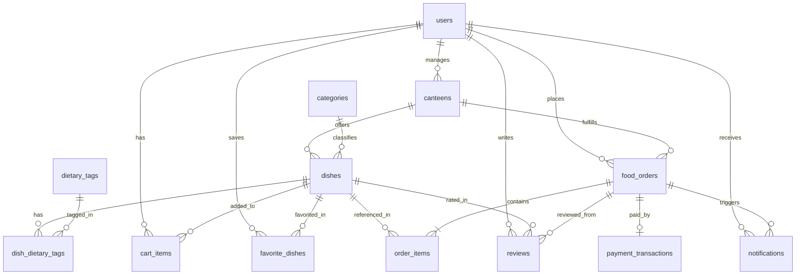

# CampusEats — Сервис предзаказа еды в буфетах и столовых кампуса

Веб-приложение для оформления предзаказа еды и напитков в университетских столовых и буфетах к конкретной перемене без очередей.

## Стек технологий

* **Бэкенд:** Java 17, Spring Boot 3.2.5 (Spring Web, Spring Data JPA, Validation)
* **Фронтенд:** Thymeleaf, Bootstrap 5 (адаптивная вёрстка под десктоп и мобильные устройства), Fetch API
* **База данных:** H2 Database (в файловом режиме PostgreSQL compatibility)
* **Маппинг и кодогенерация:** MapStruct 1.5.5, Lombok
* **Документация API:** SpringDoc OpenAPI 3 / Swagger UI

---

## Запуск проекта

1. Склонировать репозиторий и перейти в папку проекта:
   ```bash
   git clone https://github.com/IrtovaIrina/campus-eats.git
   cd campus-eats
   ```
2. Запустить приложение через Maven Wrapper или из среды разработки (IntelliJ IDEA):
   ```bash
   ./mvnw spring-boot:run
   ```
3. Открыть в браузере:
   * **Веб-интерфейс:** [http://localhost:8080](http://localhost:8080)
   * **Swagger UI (документация REST API):** [http://localhost:8080/swagger-ui.html](http://localhost:8080/swagger-ui.html)
   * **Консоль БД H2:** [http://localhost:8080/h2-console](http://localhost:8080/h2-console) (JDBC URL: `jdbc:h2:file:./data/campuseats_db`, User: `sa`, Password: пустой)

### Тестовые учётные записи

| Роль | Email | Пароль | Назначение |
| :--- | :--- | :--- | :--- |
| **Студент** (`STUDENT`) | `a.d.sokolov@campus.edu` | `student123` | Просмотр меню, фильтрация, корзина, предзаказ, оплата, трекинг, отзывы |
| **Буфет / Столовая** (`CANTEEN`) | `canteen.eng@campus.edu` | `canteen123` | Управление очередью заказов, смена статусов, CRUD меню, статистика, ответы на отзывы |
| **Администратор** (`ADMIN`) | `admin@campus.edu` | `admin123` | Сводная аналитика по кампусу, верификация и управление столовыми и буфетами |

---

## Ключевой сценарий (BPMN-процесс по архитектурным слоям)

**Сценарий:** Меню буфета ➔ Карточка блюда ➔ Корзина ➔ Оформление заказа (выбор времени и столовой) ➔ Статус-трекинг ➔ Личный кабинет с историей заказов.


---

## Архитектура базы данных (12 сущностей + таблица связи M:N)

Ниже представлена структура таблиц БД для визуализации в **Draw.io** / **DrawSQL** / **dbdiagram.io**:


### ER-диаграмма базы данных (Mermaid / Draw.io совместимая)

Эту схему также можно импортировать напрямую в **Draw.io** через меню `Arrange (Расположение)` ➔ `Insert (Вставить)` ➔ `Advanced (Дополнительно)` ➔ `Mermaid`:

